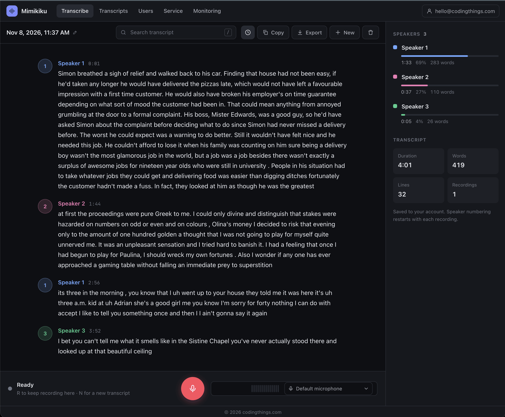
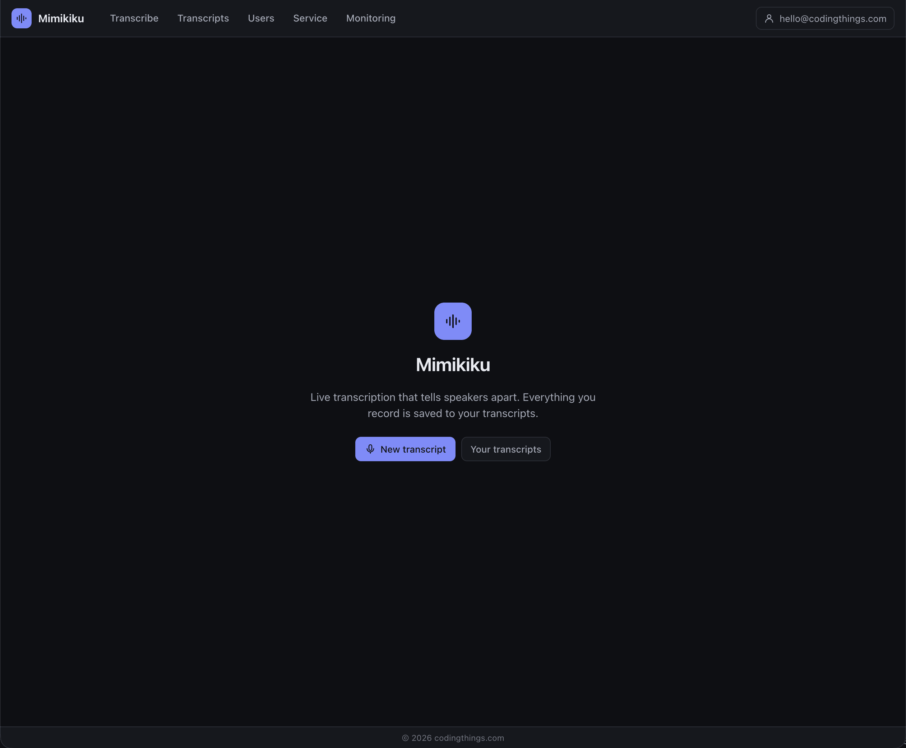
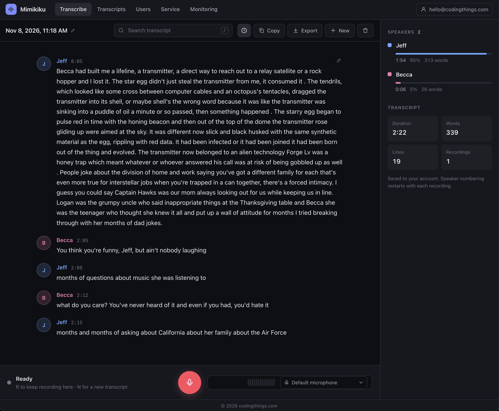
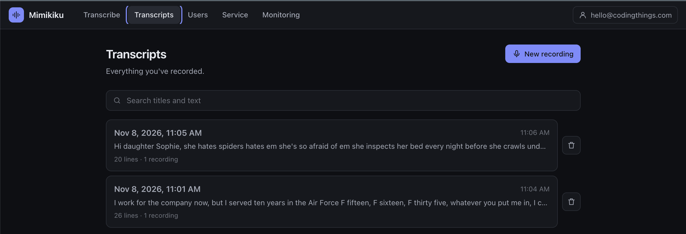
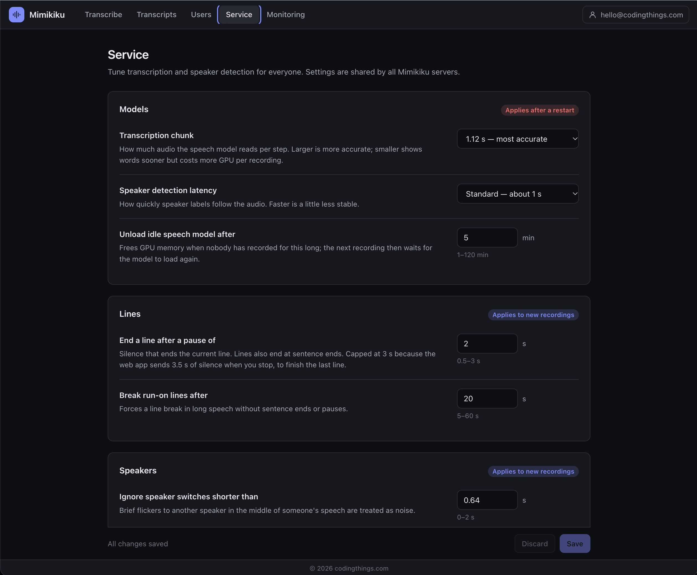
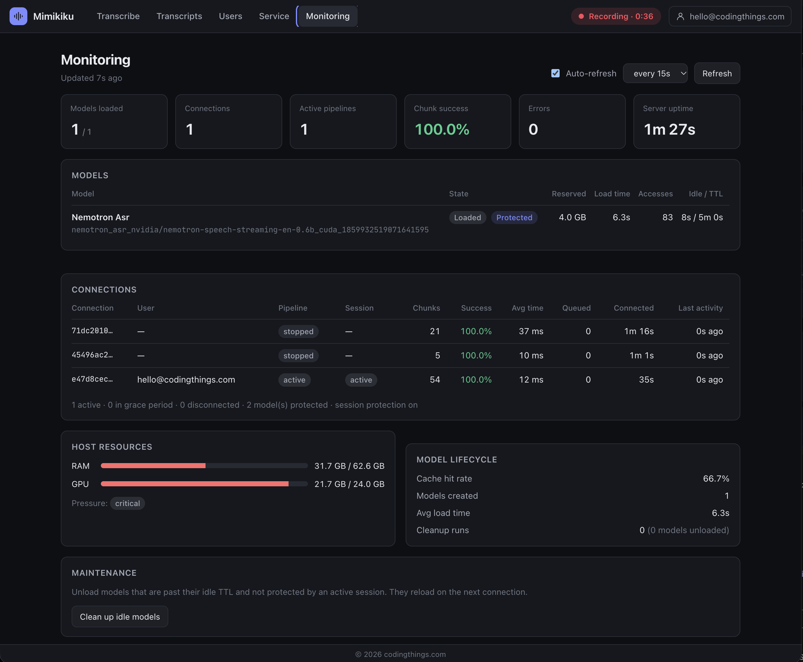

# Mimikiku

Real-time transcription with speaker labels for your team, on your own NVIDIA GPU. Audio streams over a WebSocket. NVIDIA NeMo models transcribe it live (Nemotron streaming ASR, Sortformer diarization). Transcripts are saved per user on the server.



## Quick start

You need an NVIDIA GPU, Docker with Compose 2.24 or later, and the NVIDIA Container Toolkit.

```bash
cp .env.example .env        # HF token, first admin, PUBLIC_ORIGIN, STORE_AUDIO
./docker-start.sh --build   # server on :7777, plus Mongo
```

Open http://localhost:7777 and sign in as the admin from `.env`.

### Hugging Face token

The models download from Hugging Face on the first start. The current models don't require a token, but future ones may, and anonymous downloads have lower rate limits. Set one now:

1. Sign in at [huggingface.co](https://huggingface.co) (or create a free account).
2. Go to [Settings → Access Tokens](https://huggingface.co/settings/tokens) and create a token with the **Read** role.
3. Put it in `.env`: `HUGGING_FACE_HUB_TOKEN=hf_...`

Keep it secret. `.env` is gitignored.

- [docker/README.md](docker/README.md): configuration, several servers, troubleshooting
- [docker/OLLY.md](docker/OLLY.md): optional telemetry (OpenTelemetry)

## Clients

- **Web app** (this repo): record from the mic, browse and edit transcripts.
- **[mimikiku-capture](https://github.com/codingthings-com/mimikiku-capture)**: terminal app that streams system audio or a mic. Uses an API token.
- **mimikiku-ios**: iPhone app. Coming later.

## Screenshots

| Home | Speakers renamed |
|---|---|
|  |  |
| **Transcripts** | **Service settings** |
|  |  |
| **Monitoring** | |
|  | |

## Layout

```
server/    FastAPI app: /listen WebSocket, ASR and diarizer, accounts, transcripts
webui/     Svelte 5 frontend, built into the server image
docker/    Dockerfile, compose files, telemetry docs and dashboard
```

## Tests

```bash
python -m venv .venv && source .venv/bin/activate
pip install -r requirements.txt -r requirements-dev.txt
python -m pytest server/tests/
```

## License

Copyright 2026 codingthings. Licensed under the [Apache License 2.0](LICENSE).

The NVIDIA models (Nemotron ASR, Sortformer) are not part of this repo. They are downloaded at runtime and have their own licenses.
